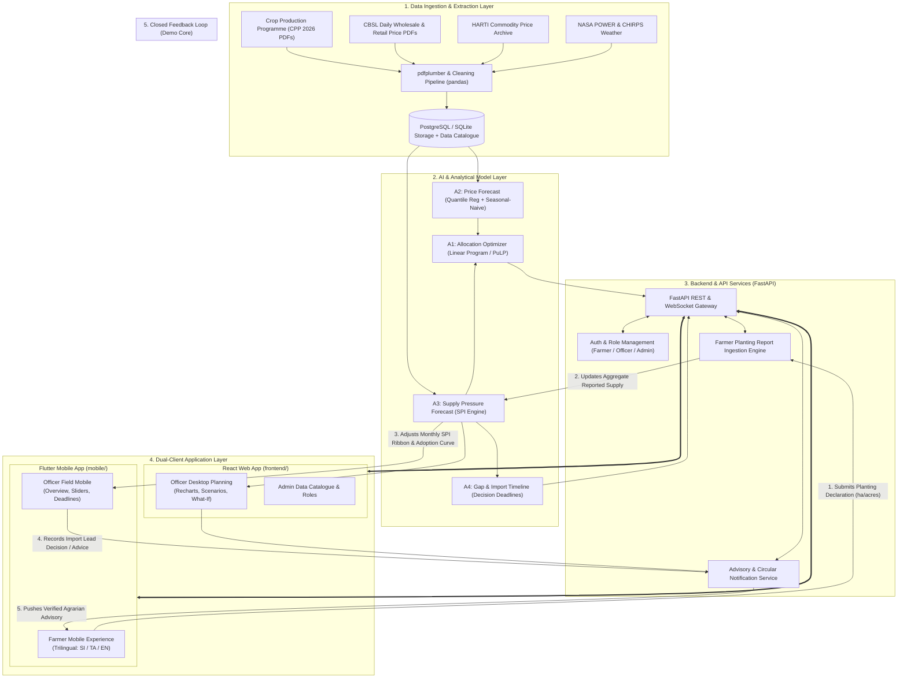
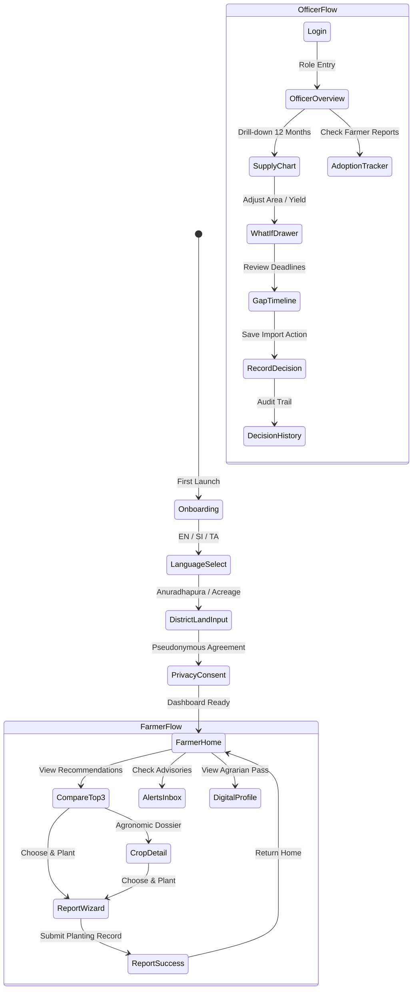
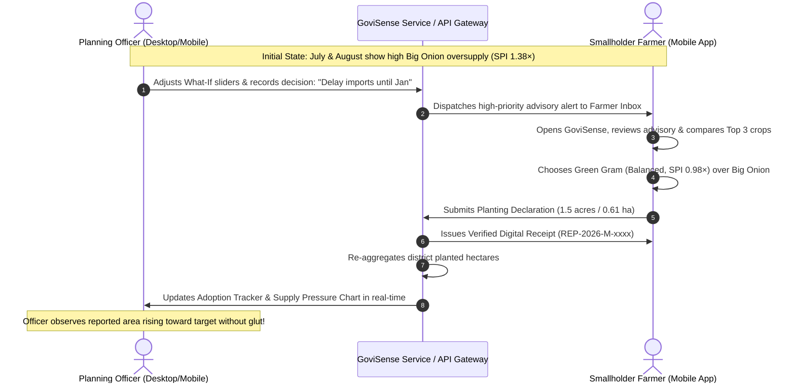

# GoviSense — Master System Engineering & Delivery Roadmap (A–Z)

**Project:** GoviSense (ModelX 2.0 · Team Darkbite)  
**Authors:** Senior Software Engineer, UI/UX Designer & System Architect  
**Domain:** Cost of Living and Everyday Economics (Sri Lankan Agriculture)  
**Pilot District & Target Crops:** Anuradhapura District · Big Onion & Green Chilli (with Green Gram & Maize)  
**Deliverable Status:** Master Architecture & Engineering Execution Blueprint  

---

## 1. System Vision & Architecture Overview

GoviSense bridges the critical information gap between national agricultural policy officers and rural smallholder cultivators in Sri Lanka. It combines public targets, price histories, weather signals, and real-time farmer planting reports into an actionable **Supply Pressure Index (SPI)** to eliminate repeating cycles of gluts and shortages.

---

## 2. Platform Strategy: Dual-Client Division of Responsibility

| Platform | Codebase | Primary Persona | Language Support | Core Responsibilities |
|---|---|---|---|---|
| **Field Mobile Client** | [`mobile/`](file:///d:/programming/Govisense/GoviSense/mobile/) (Flutter SDK) | **Smallholder Farmers** & **Field Extension Officers** | **Trilingual:** • Sinhala (`සිංහල`) • Tamil (`தமிழ்`) • English | • 1-handed mobile navigation in bright sunlight. • Top-3 crop comparison with SPI risk gauges. • 3-step planting declaration form. • Digital Govijana Seva Pass with QR code. • Field Officer mobile dashboard & what-if sliders. |
| **Desk Planning Web** | [`frontend/`](file:///d:/programming/Govisense/GoviSense/frontend/) (React 19 + Vite) | **Ministry / Department Planning Officers** & **Analysts** | **Bilingual / English Core:** • English (Primary) • Sinhala / Tamil toggle | • Deep multi-scenario modelling (`fl_chart` / SVG). • 12-month supply vs demand low-mid-high range bands. • Data provenance & extraction error catalogue. • Policy decision history and run versioning (`RUN-xxxx`). |

---

## 3. Phase-by-Phase Execution Roadmap

### Phase 0 — Core Mathematical Contracts & Metric Definitions ★
> **Objective:** Unblock all data pipelines, models, and UI teams by locking definitions.

- [x] **Supply Pressure Index (SPI) Definition:**
  $$\text{SPI} = \frac{\text{Expected Supply}}{\text{Expected Demand}}$$
  - **$\text{SPI} < 0.85$ (Shortage Risk):** Farmgate price potential high; warning for consumer shortages; officer import review triggered.
  - **$0.85 \le \text{SPI} \le 1.15$ (Balanced Market):** Domestic supply matches national consumption; farmgate prices stable.
  - **$\text{SPI} > 1.15$ (Oversupply Risk):** Market glut risk; wholesale price depression warning; officers delay imports and promote storage.
- [x] **Data Contract Schema:**
  `crop_id, district, month, supply_low, supply_mid, supply_high, demand, spi_score, confidence_level, data_version, run_id, provenance_type (target | farmer_reported)`.
- [x] **Role Hierarchy:** `Farmer` (pseudonymous, localized), `Officer` (district/national scope), `Admin` (pipeline & catalogue).
- [x] **Color Distinction Rule:** Brand emerald (`#0A5C36`) strictly decoupled from data risk signals (`#168B52` balanced, `#D44333` shortage, `#B87300` oversupply).

---

### Phase 1 — Unified Design System & Typography Tokens ★
> **Objective:** Establish tactile, high-contrast, outdoor-friendly design tokens shared across Flutter and React.

- [x] **Surface & Inks:** Warm anti-glare paper surface (`#F7F9F6`), crisp white elevated cards (`#FFFFFF`), high-contrast ink (`#0E1C15`, 14:1 contrast ratio).
- [x] **Trilingual Typography Stack:**
  - Latin/Numerals: `Inter` (tabular figures `tnum` for monetary and yield metrics).
  - Sinhala: `Noto Sans Sinhala` with 1.6–1.7 line height to eliminate diacritic clipping.
  - Tamil: `Noto Sans Tamil` with proportional glyph spacing.
- [x] **Semantic Signal Tokens:**
  - Balanced Market: `#168B52` (Background `#E8F7EE`, Border `#A6E3BF`)
  - Opportunity / Shortage: `#D44333` (Background `#FDF0ED`, Border `#F7C3BD`)
  - Caution / Glut Risk: `#B87300` (Background `#FFF7E6`, Border `#FCE0A6`)
  - Official Circular / Advisory: `#1E65D6` (Background `#EFF5FF`, Border `#BBD5FC`)
- [x] **Ergonomic Standards:** Minimum 48px touch targets for mobile thumb usability in field conditions.

---

### Phase 2 — Information Architecture & User Journeys ★

---

### Phase 3 — Shared Service Layer & Mock Data Engine ★
> **Objective:** Completely decouple UI from hardcoded constants so switching to live FastAPI is a configuration change.

- [x] **Typed Service Interface (`farmerService.ts` / `FarmerRepository.dart`):**
  - `getRecommendedCrops(district, landSize)`
  - `getAlerts()`
  - `submitPlantingReport(reportData)`
  - `recordOfficerDecision(decision, crop)`
  - `getAdoptionMetrics()`
- [x] **Official Baseline Figures (Anuradhapura 2026 Crop Production Programme):**
  - Big Onion: 2,131 ha planned $\rightarrow$ 35,051 t target ($\approx 16.45\text{ t/ha}$).
  - Chilli: 2,493 ha planned $\rightarrow$ 23,186 t target.
  - Green Gram: 1,750 ha target $\rightarrow$ domestic production deficit.
- [x] **Reactive State Broadcasting:** Live subscriber/listener notifications to trigger immediate cross-role updates.

---

### Phase 4 — Flutter Mobile Application Build (`mobile/`) ★
> **Objective:** Deliver the native mobile field application based on [`mobile-app-current-situation.md`](file:///d:/programming/Govisense/GoviSense/docs/mobile-app-current-situation.md).

#### 4.1 State & Routing Setup [COMPLETED]
- [x] Update `mobile/lib/core/theme/app_theme.dart` with complete semantic color tokens.
- [x] Implement trilingual dictionary [`mobile/lib/core/localization/app_translations.dart`](file:///d:/programming/Govisense/GoviSense/mobile/lib/core/localization/app_translations.dart).
- [x] Wrap `main.dart` with Riverpod `ProviderScope`.
- [x] Configure `app_router.dart` with dedicated `/farmer` and `/officer` branch routes.
- [x] Update `auth_page.dart` to navigate to `/farmer` on Farmer selection, and `/officer` on Officer selection.

#### 4.2 Farmer Mobile Modules ([`mobile/lib/features/farmer/`](file:///d:/programming/Govisense/GoviSense/mobile/lib/features/farmer/)) [COMPLETED]
- [x] **Farmer Navigation Shell (`farmer_page.dart`):** Bottom navigation with Home, Compare, Report (elevated FAB), Alerts (unread badge), and Profile.
- [x] **Farmer Home Tab (`farmer_home_tab.dart`):**
  - Maha 2026 Season header with 11-day decision deadline countdown.
  - Weather & drainage warning card.
  - Top 3 recommendations snapshot with profit ranges and mini SPI needle gauge.
- [x] **Compare Tab (`farmer_compare_tab.dart`):**
  - Swipeable cards for Green Gram, Chilli, and Big Onion.
  - Profit range banner, water droplets (1–3), and sowing/harvest calendar windows.
  - "Why these 3 crops?" bottom sheet modal with agronomic reasoning.
- [x] **Crop Detail Page (`crop_detail_page.dart`):**
  - Revenue vs cost breakdown.
  - Month-by-month cultivation timeline.
  - ASC field tips and soil requirements.
- [x] **Planting Report Wizard (`farmer_page.dart`):**
  - Step 1: Planned crop selector.
  - Step 2: Acreage input & irrigation source (Rainfed, Minor Tank, Major Irrigation, Agro-well).
  - Step 3: Planting date & seed source (Certified DOA, Farmer Saved, Private).
  - Encrypted pseudonymous data notice.
- [x] **Confirmation Screen (`farmer_page.dart`):**
  - Digital Cultivation Receipt with unique verification hash (`REP-2026-M-xxxx`).
- [x] **Alerts Inbox (`farmer_page.dart`):**
  - Filter tabs (All, Unread, Market, Weather).
  - "Mark Read" button & "Ask Local Agrarian Officer" direct phone dialer.
- [x] **Profile & Govijana Pass (`farmer_page.dart`):**
  - Digital Farmer ID Card (`ANU-01428`) with QR code.
  - Trilingual language toggle and manual database sync button.

#### 4.3 Officer Field Mobile Modules ([`mobile/lib/features/officer/`](file:///d:/programming/Govisense/GoviSense/mobile/lib/features/officer/)) [COMPLETED]
- [x] **Officer Overview:** KPI cards, SPI monthly ribbon, and monthly supply curve.
- [x] **What-If Sliders Sheet:** Live sliders for Planted Area (ha) and Expected Yield (t/ha) dynamically re-calculating annual harvest.
- [x] **Gap & Import Deadlines:** Shortage month countdown with action triggers (Import now / later / delay / store).
- [x] **Adoption Tracker:** Recommended vs Farmer-Reported area bars.
- [x] **Decision Recording:** Modal to record a decision and broadcast an advisory alert to farmers.

---

### Phase 5 — React Web Application Platform (`frontend/`) ★
> **Objective:** Deliver the officer planning workstation and desktop policy interface.

- [x] **Modular Architecture Refactoring:** Decoupled `App.tsx` into `tokens/`, `types/`, `i18n/`, `mocks/`, `services/`, `components/`, and `screens/`.
- [x] **Complete Farmer Web Client:** Trilingual PWA running at 390×844 resolution with mobile frame and responsive viewport.
- [x] **Officer Planning Dashboard:**
  - Interactive Supply Band SVG chart with Low-Mid-High scenario envelopes and touch month selection.
  - Live What-If control panel with area/yield sliders and percentage impact calculation.
  - 12-month SPI strip highlighting oversupply/shortage risk months.
  - Decision history audit log with run IDs and data versions.
  - Data sources catalogue with confidence badges and extraction error tracking.
- [x] **Verified Compilation:** Clean Vite build (`✓ 2056 modules transformed in 573ms`).

---

### Phase 6 — The Bidirectional Closed Feedback Loop ★ [COMPLETED]
> **Headline Demo Moment:** Protect and prove the feedback loop connecting farmers and officers.

- [x] **Reactive State Subscription in Service Layer:** Single source of truth with listener broadcasts in both Dart (`FarmerRepository` / `OfficerRepository`) and TypeScript (`farmerService`).
- [x] **Connect Flutter Mobile Reporting Directly to Officer Charts:**
  - `FarmerRepository.submitPlantingReport` updates `_reports` and fires `notifyListeners()`.
  - `OfficerRepository` calculates dynamic `getAdoptionRows()` incorporating extra reported hectares ($1880 + \text{extraOnionHa}$, $1960 + \text{extraGreenGramHa}$, $2210 + \text{extraChilliHa}$).
  - `OfficerPage` Overview tab displays "Closed-Loop Feedback Active" banner with ground-truth overlay toggle, What-If "Sync Field Ha" action, and live decentralized farmer declarations audit log.
- [x] **Verify Instant UI Update Across Role Switch in Both Mobile and Web:**
  - **Flutter Mobile (`mobile/`):** Instant role switcher in AppBars (`/farmer` $\leftrightarrow$ `/officer`). Officer decisions broadcast directly into Farmer inbox with push notification styling; farmer declarations immediately update Adoption Tracker.
  - **React Web (`frontend/`):** Top bar workspace switcher with unread badge counter. Officer decisions call `farmerService.recordOfficerDecision`; `AdoptionScreen` dynamically aggregates reported ha and renders receipt audit table; `ModernFarmerScreen` subscribes for instantaneous alert updates.

---

### Phase 7 — AI Models & Algorithmic Engines (`src/models/`)
> **Objective:** Train and calibrate the four analytical engines.

| Model Component | Algorithm / Method | Input Features | Target Output | Baseline & Evaluation |
|---|---|---|---|---|
| **A3: Supply Pressure Forecast** | Supply Accounting Model + Monte Carlo envelope | Sown extent, crop growth duration, historical yield distributions, baseline post-harvest losses (12–15%), national monthly consumption. | Monthly projected production (Low, Mid, High tonnes) and SPI score. | Compare planned vs actual 2024/25 harvest statistics. |
| **A2: Price Forecast Engine** | Quantile Regression (`LightGBM`) + Seasonal-Naive | Lagged Pettah & Dambulla wholesale prices, harvest month, rainfall anomalies (NASA POWER), import CIF parity gap. | 10th, 50th, 90th percentile predicted price at harvest. | WAPE on unseen test set; must beat seasonal-naive baseline. |
| **A4: Gap & Deadline Calculator** | Deterministic Lead-Time Countdown | Monthly supply deficit ($\text{Demand} - \text{Supply}$), sea freight lead time (6–8 weeks), quarantine buffer. | Action Deadline date; recommended import quota volume. | Verification with Ministry import timeline guidelines. |
| **A1: Allocation Optimizer** | Linear Programming (`PuLP` / `OR-Tools`) | Farmer profit maximization function subject to $\text{SPI} \le 1.15$, land suitability constraints, and minor tank water capacity. | Balanced crop quotas per Grama Niladhari division. | Agent-based simulation comparing 0%, 30%, 60% adoption. |

---

### Phase 8 — Data Pipelines & Table Extraction (`src/data/`)
> **Objective:** Clean and ingest official government datasets without manual re-typing.

- [ ] **Crop Production Programme Extraction:**
  - Automated extraction of planned extent (ha) and target production (t) for Anuradhapura and Matale from 76-page 2026 PDF using `pdfplumber`.
  - Automated 5% hand-check sample with error rate logged in [`docs/data-validation.md`](file:///d:/programming/Govisense/GoviSense/docs/data-validation.md).
- [ ] **Central Bank Daily Price Parser:**
  - Extract wholesale and retail price series for Big Onion, Green Chilli, and Red Onion.
  - Normalize dates, units (Rs/kg), and market locations (Dambulla, Pettah, Meegoda).
- [ ] **HARTI & WFP Historical Archive Ingestion:**
  - Load 10-year monthly seasonal price indices.

---

### Phase 9 — Backend API & Integration Layer (`src/api/`)
> **Objective:** Provide a fast, documented FastAPI backend with Docker deployment.

- [ ] **FastAPI Endpoints:**
  - `GET /api/v1/crops/recommendations?district=Anuradhapura&land_acres=1.5`
  - `POST /api/v1/farmer/reports` (with pseudonymous tokenization)
  - `GET /api/v1/officer/supply-chart?crop=big_onion&year=2026`
  - `POST /api/v1/officer/decisions`
  - `GET /api/v1/alerts?user_id=ANU-01428`
- [ ] **Database Schema:** SQLite for lightweight local demo, PostgreSQL-compatible for production.
- [ ] **Docker Orchestration:** `docker-compose.yml` spinning up FastAPI backend, PostgreSQL, and web client.

---

### Phase 10 — Quality, Resilience & Usability Validation
> **Objective:** Ensure field-readiness under actual agricultural operating constraints.

- [ ] **Offline Resilience:** Honest offline indicator showing exact data age ("Synced 2 hours ago"). Local cache persists top-3 advice.
- [ ] **Sinhala & Tamil Script Verification:** Check across small Android screens (e.g., 360×640) for text wrapping and zero character truncation.
- [ ] **Field Evaluation Interviews:** Conduct structured walkthroughs with 5–10 farmers and agrarian instructors in Anuradhapura as defined in proposal Section 9.

---

## 4. Work Breakdown by Team Role (from Proposal Section 8)

| Team Member | Role | Assigned Phases | Primary Deliverables |
|---|---|---|---|
| **Member A** | **Data Lead** | Phase 0, 7, 8 | PDF extraction pipelines (`pdfplumber`), data validation, data catalogue. |
| **Member B** | **Modelling Lead** | Phase 0, 7 | A2 price model (`LightGBM`), A3 supply model, backtests & error metrics. |
| **Member C** | **Backend Lead** | Phase 3, 6, 9 | FastAPI architecture, database schema, A1 optimizer, A4 gap logic, Docker. |
| **Member D** | **Product & Frontend Lead** | Phase 1, 2, 4, 5, 10 | Flutter mobile app, React web dashboard, trilingual UI, feedback loop demo. |

---

## 5. Live Demo Script (Phase 9 Minimum Viable Slice ★)

To guarantee maximum score and flawless presentation in the competition:

1. **Step 1 (Officer spots risk):** Officer opens desktop dashboard / mobile overview, views the Anuradhapura Big Onion harvest ribbon, and identifies an oversupply crisis in July/August ($\text{SPI} = 1.38\times$).
2. **Step 2 (What-if scenario):** Officer adjusts planted area slider down by 15% and watches the SPI shift back toward the balanced green zone.
3. **Step 3 (Action recorded):** Decision deadline appears (May 14); officer records decision *"Delay imports until late harvest to protect domestic prices"*.
4. **Step 4 (Farmer advisory received):** Farmer opens mobile app in Sinhala, receives the new advisory alert, and compares the Top 3 crops. Green Gram shows balanced demand ($\text{SPI} = 0.98\times$) and lower water requirement.
5. **Step 5 (Farmer reports planting):** Farmer declares 1.5 acres of Green Gram and receives verified Digital Cultivation Receipt `REP-2026-M-0891`.
6. **Step 6 (Closed Loop Verified):** Officer switches to Adoption Tracker; Green Gram reported area increments live with a visible audit tag!

---

## 6. Cut Order (Contingency Protocol)

If time is constrained before the competition freeze:
1. **First to cut:** SMS integration (in-app alerts only as specified in proposal).
2. **Second to cut:** Secondary vegetable crops (keep Big Onion, Green Chilli, and Green Gram strictly locked).
3. **Third to cut:** Adoption tracker history graphs (reduce to simple comparison bar).
4. **NEVER CUT (Core Pillars):**
   - Supply pressure forecast (SPI ribbon & chart)
   - Top-3 balanced crop comparison
   - What-if area and yield sliders
   - Gap timeline with decision deadlines
   - Farmer planting report form
   - Bidirectional closed feedback loop

